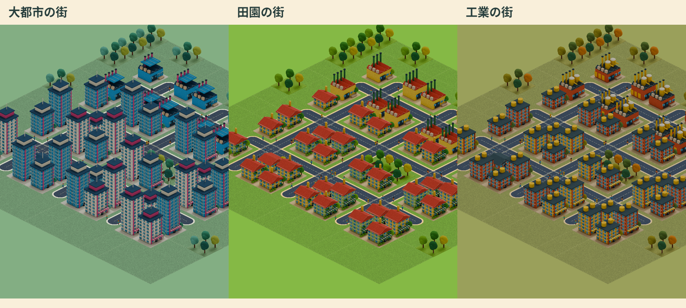

# PIXELCITY

フェルトで仕立てた温かな街を、市長として育てるAndroid向け都市経営ゲームです。
球体の惑星に住宅・商業・工業を区画し、道路、電気、水、公共サービスと財政を整えます。街へ近づくと、斜め上から立体的な街並みを眺められます。
秘書ひよりと新米市長の物語を進め、大都市・田園都市・工業都市の3シナリオへ進めます。



## 濃い青の選択表示と、ひよりの開閉（0.6.5）

選択したマスの塗りと枠線を濃い青に変更しました。地形編集の選択枠も同じ色です。
上部の「座標指定」の隣にある「ひより」で、チュートリアルの顔・メッセージ欄と、シナリオの案内欄を表示／非表示にできます。
非表示中はその場所でもマップを操作でき、物語・資金・選択中のマスは保持されます。画面回転後も開閉状態を維持します。
新しい助言はボタンの未読印で知らせ、勝手に開き直しません。「市政」→「市政手帳」から自分で説明を読むこともできます。
[仕様と検証記録](docs/HIYORI_VISIBILITY.md)

## 地図を広く眺める操作と横画面（0.6.4）

建設メニューは開始・再開時に閉じています。上部の「調査」の隣にある「建設」で開閉します。
閉じている間は一本指のドラッグで地球・地図を移動し、開いている間は一本指でマスを選択します。どちらも二本指で移動と拡大縮小ができます。選択後の「実行」で建設し、メニューを閉じると未実行の選択を取り消します。

縦画面では下部の建設トレイ、横画面では右側の施設一覧を表示します。横画面の施設分類は一覧上部から切り替え、施設は縦スクロールで選べます。
「市政」から都市情報・予算・地形編集・記念建築・市政手帳へ移れるため、建設メニューを開かずに経営できます。
タイトルは横画面用の左右配置、ひよりの物語は相談ボタンから全文を読む構成に対応しました。画面回転時は同じ都市と描画画面を維持し、カメラ穴の左右の余白も確保します。
[操作仕様と検証記録](docs/RESPONSIVE_CONSTRUCTION.md)

## 発展した世界と読みやすい地形編集（0.6.3）

模範都市の一覧に「発展した世界」を追加しました。イギリスの港町、アメリカ東海岸の大都市、ヨーロッパ大陸の田園都市、中国大陸の工業都市が、同じ512×512マスの惑星で共存します。
初期人口は3,140人、共有資金は$1,130,000。画面上部の「都市移動」で各都市を訪れ、その続きを建設・経営できます。各街の建築様式と移動先は保存・再開にも対応します。
既存の保存都市へ自動的に追加・移転することはありません。新しい模範都市として保存先を選んで開始します。

地形編集の背景・ボタン・文字・押下色を明示し、明るいクリーム色の面と濃い文字に統一しました。「地形を適用」は深緑に明るい文字で表示します。土地属性・筆・座標入力の画面も同じ明るい配色です。
[仕様と検証記録](docs/DEVELOPED_WORLD.md)

## カメラ穴を避ける画面配置（0.6.2）

カメラ穴とステータスバーの下端を端末から取得し、その下に8dpの余白を確保します。
都市の人口・資金・操作ボタン、各情報画面、タイトル・保存枠・模範都市メニューを同じ基準で配置します。
メニューをスクロールしても、文字やカードがカメラ穴の領域へ入り込みません。
[表示と操作の検証記録](docs/CAMERA_SAFE_AREA.md)

## 地域に根ざした模範都市（0.6.1）

新しく開始する模範都市を、港町はイギリス、大都市はアメリカ東海岸、田園都市はヨーロッパ大陸、工業都市は中国大陸へ配置しました。
海・川・山を避け、地域の陸地に沿って道路と街区を構成します。港は実際の海岸に接し、住宅や工場、公共設備も地域の広さに合わせています。
**保存済みの都市の場所・建築・地形編集は変更しません。**

機能名は「地形編集」に統一。編集トレイや座標指定を開いてもBGMが続き、市政の時間だけが止まります。BGMを無効にした設定と、アプリを離れた際の音声停止は維持します。
[配置・音声・保存の検証記録](docs/REGIONAL_CITY_VALIDATION.md)

## 球体で経営する都市（0.6.0）

都市と惑星を一つの表示に統合しました。同じ512×512マスの球面で、建設・撤去・調査・予算・公共サービス・物語を進めます。
拡大するとフェルト建築、道路、走る車、散歩する人々が見え、縮小するとその街を含む惑星全体を見渡せます。
既存デザインの322種類を実際の3Dモデルとして再利用し、遠景には軽量モデルを用います。

- 建設メニュー表示中は一本指で土地を選び、「実行」で建設。二本指で回転・ピンチで拡大縮小。
- 建設メニュー非表示中は一本指でも回転。「街の中心」「全景」「座標指定」で目的の場所へ移動。
- 「地形編集」は同じ球体の上に開く無料の編集トレイ。完了後も同じ場所で市政を続けられます。
- 既存の地形、都市、資金、10保存枠を保持。球体への統合に伴う初期化はありません。

[統合画面の仕様と検証](docs/UNIFIED_CITY_VALIDATION.md)

## 土地属性を描く惑星（0.5.3）

惑星の表面は、保存された512×512マスの土地属性から1マスずつ描画します。
森林・砂漠・海・雪原などをそれぞれの色と素材感で表し、拡大すると木、砂丘、火口、氷の稜線などが現れます。
地形の変更・取消をそのまま見た目へ反映。大陸配置や高低差には地球由来のデータを使い、表面への衛星写真の貼付けを廃止しました。
[土地属性表示の仕様と検証](docs/TILE_PLANET_VALIDATION.md)

## 安定性の改善（0.5.2）

実機の応答停止ログから未解禁ボタンの描画負荷を特定し、描画命令を削減しました。
画像を表示寸法に合わせて読み込み、キャッシュに上限を設定。惑星の頂点データの複製も削減しています。
同一エミュレーターで都市と惑星を6往復した際の最大PSSは約362 MiBから171 MiBへ低減しました。
[原因・測定条件・検証結果](docs/PERFORMANCE_VALIDATION.md)

## 地球の地形と地形編集（0.5.1）

都市画面下部の「地形編集」から、開始時点から無料で利用できます。
惑星は **512×512＝262,144マスの、一つにつながったフィールド** です。
1マスごとに平野・海・川・山・山脈・火山・森林・熱帯雨林・砂漠・雪原・氷河を3D形状で配置できます。

NASAのBlue Marble衛星画像とGEBCO由来の標高・海底資料から、**自然な大陸・海岸線・山脈を持つ地球**を再現します。
中央の四角い平野は廃止し、北米の自然な平野から都市を始めます。
ほかの土地も、地形編集で平野に変更したマスへ、同じ都市の住宅や道路を建設できます。
市の資金・交通・公共サービス・物語はフィールド全体で共通。建設できるのは平野のマスのみです。

惑星の回転・拡大に加えて、0〜511の座標指定、1マス・4×4・16×16・32×32の筆、取消に対応。
地形変更は無料で、編集中は市政の時間が停止します。
建築のあるマスを平野以外に変更すると建築を保管し、平野へ戻すと復元します。
「海面・海底」で海面を除き、海嶺や海溝を観察できます。起伏は表示上65倍に強調しています。
旧形式の地形は地球として再生成し、建築のある敷地を初期地点へ移します。旧海岸や未建設の四角い平野は引き継ぎません。就任日誌の最後に、ひよりが短く御案内します。

[惑星の仕様・操作・保存互換性](docs/PLANET.md) · [地球版の資料と検証記録](docs/EARTH_VALIDATION.md)

## 街並みと操作

建築・公共施設・記念建築・7車種・ヨットに、都市様式専用161画像と歩行者48画像を加えた322画像を3Dからレンダリング。
壁や屋根は毛羽立つフェルト、窓は布のアップリケ、樹木は綿を詰めたような丸い形です。
草地・砂浜・道路も布地で、海は青いフェルトを波形に重ねて縫った表現になっています。
アプリアイコンも同じ素材で作った、縫い目のある3棟の街です。[アイコンと検証記録](docs/FELT_ICON.md)
大都市は青と白の高層建築、田園は赤い屋根と豊かな緑、工業都市は煉瓦と黄色い設備。
古代・未来・欧州・和風にも専用の建築と色を用意しました。街の歩道を、服装の異なる人々が散歩します。

動くタイトル背景、大きなOutfitロゴと操作カード、漢字表記に統一した都市情報を採用。
ピンチの固定点と描画の座標式を統一し、連続した拡大縮小に対応しています。
[都市の個性・車と歩行者・素材の再生成方法](docs/CITY_PERSONALITIES.md)と[検証記録](docs/CITY_LIFE_VALIDATION.md)を参照してください。
記念建築の形状はCC0の写真を参考にした独自モデルです。写真測量ではなく、見えない部分や細部は推定・簡略化しています。

## 遊びかた

1. 道路と発電所をつなぎ、沿道に住宅・商業・工業を指定します。大通り・鉄道も沿道アクセスに使えます。
2. 給水塔や浄水場で水を届けると、区画がさらに高い段階へ育ちます。
3. 公園・学校・医療・警察・消防で暮らしを支え、公害・ゴミ・渋滞を抑えます。
4. 「予算」で税率を調整し、「都市情報」で統計・重ね地図・条例・設定を確認します。
5. 「調査」を選んで敷地をタップすると、接続・地価・公害と、次の発展に必要な条件が分かります。
6. 人口に応じて交通施設や世界の建築が解禁されます。資金が負のまま12か月続くと財政破綻です。

マップは1本指でなぞって選択し、「実行」で建設します。「取消」で取り消せます。
2本指で移動、ピンチで拡大縮小。選択だけでは資金は減りません。
時間は停止・1倍・2倍・4倍・10倍・30倍に切り替えられます。通常は8秒で1か月です。

新しいフィールドは **512×512マス**、**自然に存在する平野** から都市を育てます。秘書ひよりと進める5章18場面の就任日誌、自由開始、
4つのお手本都市から選べます。
「新規開始」では、新米市長が秘書ひよりと最初の住民を迎え、商店街を育てます。
広場か診療所を選び、公共サービスを保って3か月連続の黒字を目指します。
[就任日誌の構成と進行条件](docs/TUTORIAL_STORY.md)。お手本は同じ512×512の惑星上で、地域の陸地に合わせた街の経営を引き継げます。

就任日誌の終了後は、ひよりと進める **大都市・田園都市・工業都市** の3シナリオへ分岐します。
各5章の物語で、住民との対話、企業との協定、環境投資、防災などの政策を選び、実際の街を完成させます。
政策には導入費と毎月の費用があり、人口・生活環境・半年間の黒字を両立することが必要です。
[3シナリオの物語・完成条件](docs/SCENARIOS.md)。完成した街は、そのまま経営を続けられます。

- **木漏れ日の港町／イギリス**：海辺の商店街、色とりどりの家、緑の広場。
- **大都市／アメリカ東海岸**：高密度の住宅・商業とランドマーク。
- **田園都市／ヨーロッパ大陸**：農地と再生可能エネルギー、鉄道。
- **工業都市／中国大陸**：住宅と工場を分け、商業・緑地でつなぐ産業の街。

10個の保存枠があります。操作後とアプリの一時停止時に自動保存します。
Androidの戻る操作で「保存してタイトルへ」を選べます。

## 開発

Kotlin 2.2.20 / AGP 8.13.0 / Gradle 8.14.3 / Java 17。
Android SDK 36でビルドし、Android 8.0（API 26）以降に対応します。
`local.properties` の `sdk.dir` を自分の SDK に設定してください。

```bash
./gradlew assembleDebug testDebugUnitTest lintDebug
```

APK：`app/build/outputs/apk/debug/app-debug.apk`。
保存を扱う端末テストは、開発用エミュレータを明示して実行します。テストはアプリの保存枠を初期化します。

```bash
ANDROID_SERIAL=emulator-5580 ./gradlew connectedDebugAndroidTest
```

旧パレット描画の回帰確認用画像を出力する場合（現在のゲーム画面は端末テストで検証）：

```bash
./gradlew testDebugUnitTest -Ppixelcity.preview="$PWD/artifacts/preview"
```

都市画面の描画はカスタムViewと高解像度の3D由来画像による2Dです。惑星画面はOpenGL ES 2.0による実時間3Dです。Android Canvasのフィルタリングを使い、
浮動小数点の位置・倍率で地面、建築、移動中の車、選択表示を描きます。
シミュレーションはタイル単位の簡略モデルです。
個々の市民の通勤経路、自由曲線の道路、都市画面の3Dカメラ回転、上下に重なる交通網は実装していません。
地下鉄も現在は専用のタイルを使います。

[現在の仕様](docs/SPEC.md) · [バランスと検証](docs/BALANCE.md) ·
[素材と出典](docs/ASSETS.md) · [現行版の検証記録](docs/PLANET_VALIDATION.md) · [リリース手順](play/RELEASE_CHECKLIST.md)

## ライセンス

コード・独自描画・合成音は [MIT](LICENSE)。同梱フォント DotGothic16・Outfit は SIL OFL 1.1、
現在のフェルト素材・植物モデルは独自制作のMITです。[現行素材の台帳](visual-source/felt-sources.json)と、記念建築の参考写真・旧版の素材の[CC0出典台帳](visual-source/sources.json)を参照してください。
アプリに広告・解析SDK・課金・ネットワーク通信はありません。
保存データは端末のSharedPreferencesにあり、Androidの設定に応じてOSのバックアップ・端末移行の対象になります。

BGMは都市の成長・シナリオ・財政に合わせたオリジナル5曲。柔らかな鍵盤とベースを中心に、建設や市政の通知にも15種類の効果音を用意しています。[音の設計](docs/AUDIO_DESIGN.md)。
