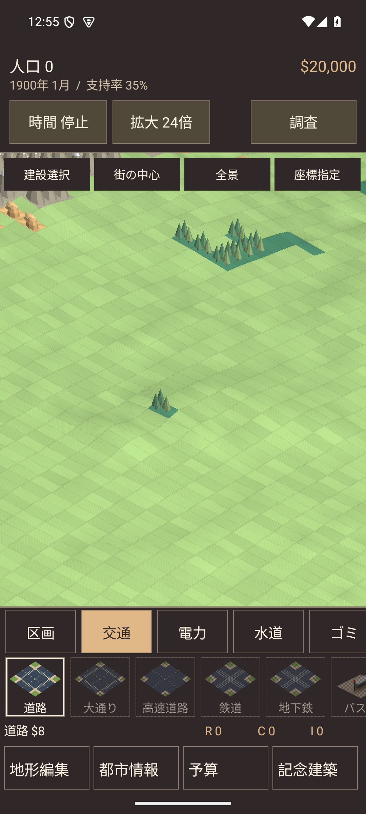
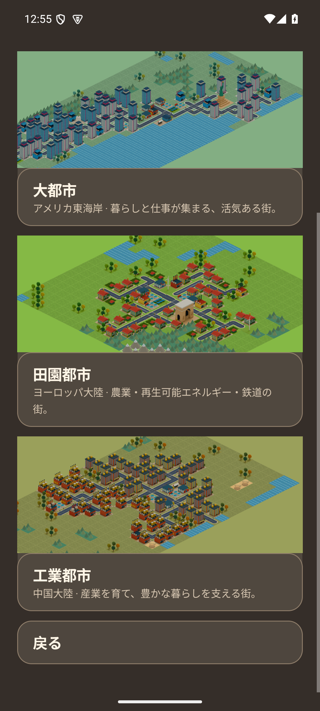

# カメラ穴を避ける画面配置（0.6.2）

2026-09-13。`io.github.hatake716.pixelcity`、versionCode 17。

## 原因と修正

都市のCanvas描画はステータスバーの高さだけを余白にしていた。カメラ穴の下端がそれより低い端末では、人口や資金の行がカメラ穴の高さと重なっていた。ネイティブのメニューは画面切替時のInsets再配信が不十分で、スクロール時に余白外への描画も許可していた。

- `systemBars`と`displayCutout`の共通安全領域を取得し、上端に追加の8dpを確保する。欄が一時的に非表示でも、余白を詰めて操作位置を動かさない。
- 都市のHUD、予算・都市情報・色調・記念建築・メッセージ・市政手帳へ同じ上端を適用。変更時には球面の表示領域も再配置し、描画とタッチ判定に同じ位置を使う。
- タイトル・保存枠・模範都市のメニューは、画面への追加時と切替時に現在の安全領域を適用する。
- ScrollViewは余白の内側で内容を切り取り、スクロール中も文字・カード・ボタンがカメラ穴の領域へ入り込まない。
- 背景の街並みは端まで表示する。アプリの文字・操作部品がカメラ穴に重ならないようにする変更であり、OSの時計・通知アイコンは維持する。

保存形式・都市・地形・財政・音声の処理は変更していない。

## 検証

API 35・1080×2400の開発用エミュレーターで検証。実際のカメラ穴の安全上端128pxとステータスバー63pxの両方を考慮し、8dp（この端末では21px）を加えた149pxを余白にする。都市の整数倍率描画では論理座標を切り上げ、安全上端を縮めない。

`CameraSafeAreaTest`の3件は、レイアウト値だけでなく実際の描画画素を確認する。

1. タイトルから模範都市・保存枠へ切り替え、スクロールした状態も含め、上部の予約領域へ内容を描いていないこと。
2. 都市の全9画面状態で、予約領域が無地であり、文字やボタンが存在しないこと。
3. レイアウト後に240pxまで深いカメラ穴を模擬し、HUDと球面の表示範囲が移動すること。移動後の「調査」ボタンが描かれた位置で反応すること。

単体テスト254件成功、失敗・スキップ0件。Lintはエラー0件・既存警告37件。Debug・AndroidTest・Release（R8）のビルドに成功。全644モデルと地形データがDebug・Release双方でソースと一致した。

Androidでは`CameraSafeAreaTest`3件、`UnifiedCityTest`6件、`StoryFlowTest`3件の**計12件が成功**（113.107秒）。安全領域の描画に加え、球面での建設・撤去・ピンチ・車と歩行者・地形編集・画面復帰、就任日誌の開始から終了までの操作、予算閲覧中の時間停止を確認した。

### 実際の画面

| 都市の上部表示 | スクロール後の模範都市メニュー |
|---|---|
|  |  |

[タイトル画面](images/camera-safe-title.png)

## 配布物

実機更新用APK：`artifacts/PIXELCITY-0.6.2-debug.apk`、24,530,828 bytes。従来と同じDebug署名。

- APK SHA-256：`4156b70376db92957377095e5581a26f916a1046c708cd67417eef2dc9742d0d`
- 署名SHA-256：`2c53b411c1193758289715cc230989564a571259b2eb4f5702b774c07a515e87`
- Release APKはビルド検証用の未署名版。

記録はGit管理外の`artifacts/camera-safe-area/`に保存。GitHub公開・Play Console提出は行っていない。

## 実機更新

2026-09-13 12:57 JST、Pixel 10aを0.6.1 / versionCode 16から0.6.2 / versionCode 17へ、同じ署名のAPKで`install --no-incremental -r`更新した。更新前のAPK・保存データを非公開ディレクトリへ退避した。

インストール成功、アプリ本体の起動`Status: ok`、稼働中PIDを確認。更新前後のSharedPreferencesは**バイト単位で一致**し、既存の保存項目2件の変更・削除・追加はなかった。実機から読み戻したAPKと配布APKのSHA-256も一致した。確認した起動プロセスに致命的例外はなかった。

実機では上書き更新と起動を確認。操作・描画・カメラ穴の模擬試験は開発用エミュレーターで行い、実機への操作入力・データ消去・アンインストールは実施していない。記録は非公開の`device/delivery.json`。
