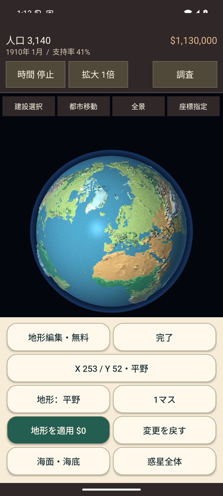
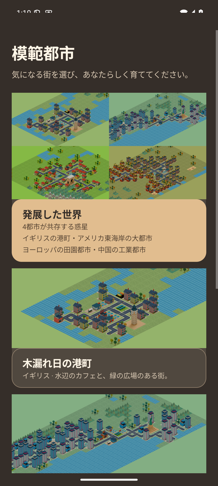
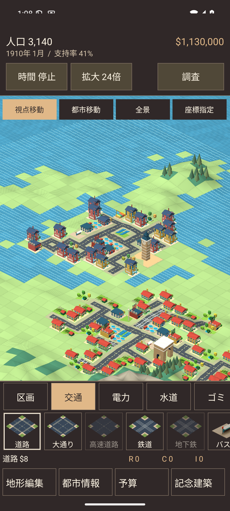
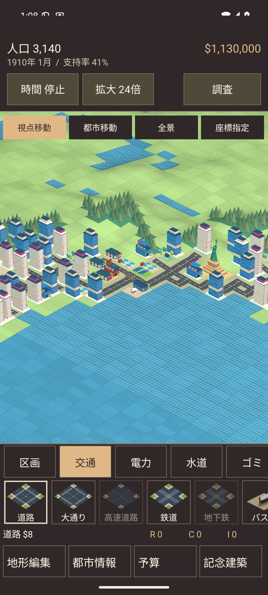
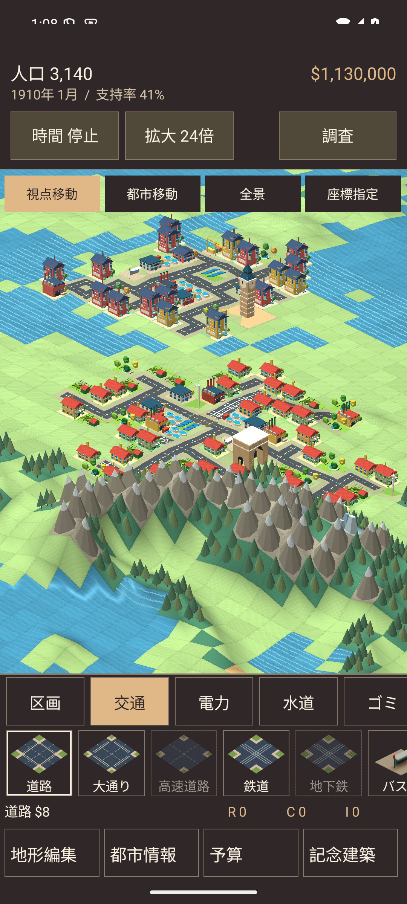
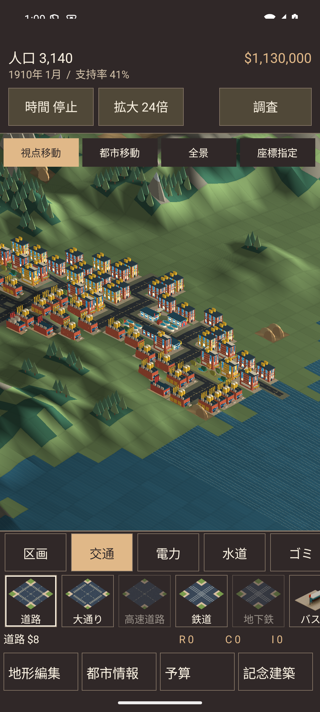

# 発展した世界と地形編集の可読性（0.6.3）

2026-09-13。`io.github.hatake716.pixelcity`、versionCode 18。

## 地形編集の配色

アプリの暗いテーマから継承したボタン背景に、濃い文字色だけを指定していたことが低コントラストの原因だった。
編集用の明るいテーマと、ボタンの背景・文字・枠・押下色を組み合わせて指定する。

| 対象 | 背景 | 文字 |
|---|---|---|
| 編集パネル | `#F7ECD7` | `#193034` |
| 通常ボタン | `#FFF8EB` | `#193034` |
| 地形を適用 | `#245E50` | `#FFF8EB` |
| 補足・入力ヒント | `#F7ECD7` | `#4F625B` |

土地属性・筆の大きさ・案内・座標入力へ同じテーマを適用。通常のボタン文字は16sp、最小高52dp。文字量に応じて高さを広げ、画面の55%を超える場合は編集トレイをスクロールできる。
編集中の時間停止・BGM継続、無料編集、取消と建築復元は維持する。

## 一つの惑星にある4都市

タイトル → 模範都市 → **発展した世界** → 保存先 → 開始。
保存が一つもなければ、最初の空き枠を使用する。既存枠を選んだ場合は従来と同じ置換確認を行う。

| 都市 | 地域 | 初期建築様式 |
|---|---|---|
| 木漏れ日の港町 | イギリス | 欧州 |
| 大都市 | アメリカ東海岸 | 大都市 |
| 田園都市 | ヨーロッパ大陸 | 田園 |
| 工業都市 | 中国大陸 | 工業 |

既存の `RegionalShowcase.build` で作る4つの模範都市の建築・道路・施設・記念建築を、地域ごとの実際の位置に配置する。
海・川・山と未建設の地形は元の地球を保持する。初期人口3,140人、共有資金$1,130,000。税率9%、リサイクル条例有効。
資金、公共サービス、時間、都市統計は一つの市政として扱い、独立した4つのセーブを同時に動かす方式ではない。

初期表示は惑星全景。「都市移動」で各街へ24倍の近景で移動し、「全景」で星全体へ戻る。住宅・公共施設の増設、予算調整、地形編集を続けられる。
4つの街の移動先と、既存敷地の個別の建築様式を保存する。都市情報で全体の建築様式を明示的に変更すると全体へ適用し、移動先は保持する。

保存済み都市を自動生成し直す処理はない。従来の4都市も引き続き一覧から個別に開始できる。

## メモリと保存

- 全景を生成するときに作る512×512マスの都市・惑星は一組だけ。小さな4つの地域プレビューから占有敷地を転写し、海岸の四角い貼り付けを避ける。
- 一覧の4分割プレビューと各都市カードは、地域ごとの小さな都市と画像キャッシュを共有する。
- 建築様式は占有敷地だけの疎なマップとして保存し、惑星全域の追加配列を作らない。描画用には変更不能の写しを渡す。
- 既存のGLモデルキャッシュ上限、描画数・頂点数上限、縮小モデルは維持する。
- 保存形式には省略可能な `localStyles`・`destinations` を追加する。これらがない既存の保存データは、従来の外観・場所で読み込む。

## 検証

JVMテスト257件成功、失敗0件。`DevelopedWorldTest`では、4都市の全占有マス・建築段階・記念建築の親座標・様式が元の地域都市と一致し、空き地の属性は元の地球のままであることを確認した。
全住宅・商業・工業区画で道路・電力・水道が利用できる。地形編集の保管建築、任意の所持金、移動先と様式を保存・再開しても、新たに都市を生成し直さない。

災害なしで24か月の自動進行を検証：人口3,140→3,332、資金$1,130,000→$1,143,491。
終了時の電力は供給12,200／需要7,390、水道は供給33,200／需要6,076。災害ありの全状況で成長・黒字を保証する試験ではない。

Lintはエラー0件・既存警告37件。Debug・AndroidTest・Release（R8／資源縮小）のビルドが成功し、全644モデルと726,504 bytesの地形データがDebug・Releaseともにソースと一致する。

API 35・1080×2400の開発用エミュレーターで、新規操作テスト2件と回帰テスト7件が成功した。
新規テストは初回にテスト側の参照名・座標取得・入力完了待ちを修正し、該当ケースを再実行して成功を確認した。

- 「発展した世界」のカードを実際に押して開始し、「都市移動」ボタンから4地域へ移動する。各地域の建物が描かれ、保存・再起動後も移動先と外観が復元される。
- 編集トレイの全9ボタンについて、端末のスクリーンショットの背景色と実際の文字色からコントラストを確認。通常時は約13.13:1、適用ボタンは約7.12:1。押下状態も含めた18サンプルの最低値は約4.91:1で、4.5:1を下回らない。
- 4つの個別模範都市、既存保存の位置・建築・資金、編集と画面復帰のBGM、消音設定、チュートリアルの時間停止を再確認。
- タイトル・各メニュー・全9都市画面のカメラ穴回避と、深いカメラ穴を模擬した際の描画・タッチ位置の一致を再確認。

| 読みやすくした地形編集 | 一覧の新しいカード |
|---|---|
|  |  |

| イギリスの港町と欧州の田園都市 | アメリカ東海岸の大都市 |
|---|---|
|  |  |

| ヨーロッパ大陸の田園都市 | 中国大陸の工業都市 |
|---|---|
|  |  |

## 配布物と実機更新

更新用APKは `artifacts/PIXELCITY-0.6.3-debug.apk`、24,977,062 bytes。従来と同じDebug署名。

- APK SHA-256：`0a6b5f316aa6bc96fc0a5323d43f087cd98b5a4e7b2835ba96ea7eb012ef86eb`
- 署名SHA-256：`2c53b411c1193758289715cc230989564a571259b2eb4f5702b774c07a515e87`
- Release APKはR8と資源縮小のビルド検証用の未署名版。

2026-09-13 13:11 JST、Pixel 10aを0.6.2 / versionCode 17から **0.6.3 / versionCode 18** へ同じ署名で上書き更新した。
更新前のAPK・保存データを非公開ディレクトリへ退避し、インストール成功・本体起動・稼働中PIDを確認した。
更新前後のSharedPreferencesは**バイト単位で一致**。既存の保存項目2件の変更・削除・追加はなかった。実機から読み戻したAPKも配布APKとSHA-256が一致し、起動時の致命的例外はなかった。

実機はデータを保持する上書き更新と起動のみを確認した。操作・描画・音声の検証は開発用エミュレーターで行った。
記録はGit管理外の `artifacts/developed-world/`、実機バックアップは所有者だけがアクセスできる `device/` 配下。GitHubへの公開、Play Consoleへの提出は行っていない。
