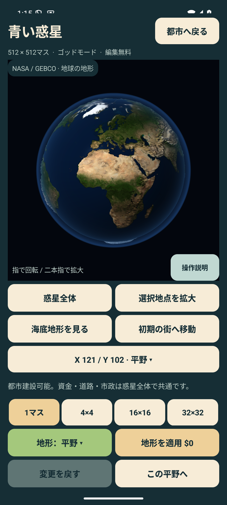
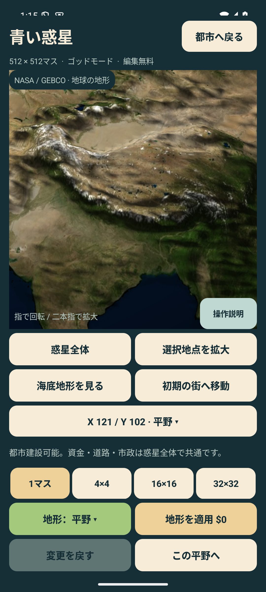
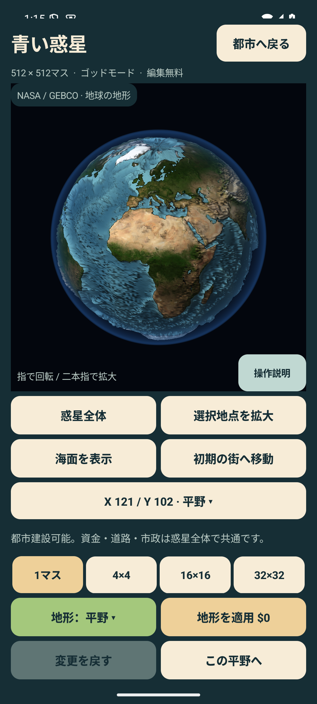
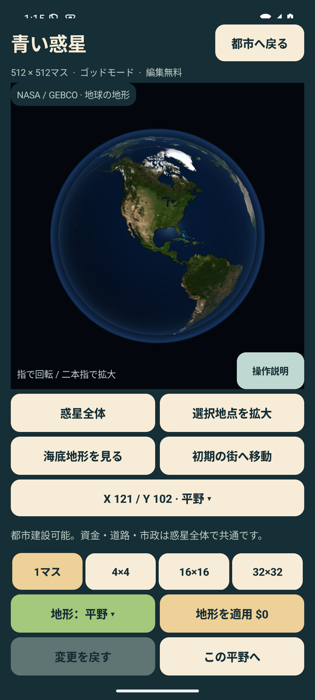

# 自然な地球への更新と検証（0.5.1）

2026-09-13。versionCode 12、applicationId `io.github.hatake716.pixelcity`。

## 変更結果

中央128×128マスを整地する初期生成を廃止した。地球全体は512×512マスのまま、NASAの衛星画像とGEBCO由来の資料から自然な大陸・海岸・高低差を生成する。新規都市は北米の自然な低地、X=121 / Y=102から開始。チュートリアルの建設用地は既存の平野を検索して決め、四角い平野を上書きしない。

球面は実際の標高で変形する。ヒマラヤやアンデスなどの山脈の起伏を光と陰で表す。地球規模でも起伏を確認できるよう、高さは65倍に誇張。通常の海面表示に加え、「海底地形を見る」で負の標高を持つ海底を観察できる。

元の地球は連続した標高メッシュで表示し、同じ山や木を碁盤目状に敷き詰めない。地形編集の編集地点には指定した高さ・色と独自の詳細3D形状を使用する。都市画面はフェルトのクオータービューで、平野の建設制限・無料の地形編集・11種類の地形・都市への移動を引き続き利用する。

## 実際の画面

以下はエミュレーターのAndroid合成画面を直接保存したもの。OpenGLの描画結果を含む。

| 自然な地球の全景 | ヒマラヤの立体地形 |
|---|---|
|  |  |

| 海底地形 | 南北アメリカ |
|---|---|
|  |  |

## 原資料・加工

- [NASA Blue Marble Next Generation base map](https://science.nasa.gov/earth/earth-observatory/blue-marble-next-generation/base-map/)。2004年7月の衛星合成画像。NASA Earth Observatory / Reto Stöckli。
- [NASA topography / bathymetry maps](https://science.nasa.gov/earth/earth-observatory/blue-marble-next-generation/topography-bathymetry-maps/)。GEBCO / British Oceanographic Data Centre、NASA Earth Observatory / Jesse Allen。
- [NASA画像使用ガイド](https://www.nasa.gov/nasa-brand-center/images-and-media/)と[GEBCOデータの利用条件](https://www.gebco.net/data-products/gridded-bathymetry/terms-of-use)を確認。出典をアプリ内ライセンス画面にも収録した。
- 衛星画像を4096×2048へ縮小。GPUの最大テクスチャ寸法が4096未満なら2048へ縮小して読み込む。
- 標高はNASA公開の0〜6,400m、海底は−8,000〜0mの8bit濃淡図から換算し、512×512の等積格子へ再投影。高さ・地形分類・元の色を圧縮バイナリへ保存する。
- 地形分類は写真の色、標高、緯度によるゲーム用の推定。厳密な土地被覆分類や測量用の地形モデルではない。海面、大気、編集後の地形は独自描画。
- 元ファイルと加工後ファイルのSHA-256、URL、加工内容は`app/src/main/assets/earth/sources.json`。再生成スクリプトは`tools/planet/`。動作中のダウンロードは不要。

## 保存形式

v7で初期都市座標、地球データ版、海底表示を保存。v7の地形編集はそのまま再開する。

v1〜v6の都市をアプリで開くと、旧地形を地球として再生成する。建築が存在する敷地のみを新しい初期地点へ移し、資金・税率・物語を保持する。空の矩形用地、海岸、旧形式で編集した地形は引き継がない。保管中の建築は通常の敷地へ戻す。南北端を越える旧敷地など、移動先が有効でないものは除外する。この移行は、既存都市の地形互換性より自然な地球を優先する今回の依頼に沿う。

## 検証

- JVM **242件成功、失敗0件**。既知の陸域・海域の標高と地形、自然な初期用地、旧地形の再生成と一度だけの移行、地形編集と取消、山と海底の頂点半径、経度境界と極点の連続性、保存往復を含む。
- 自然な512×512の地球上で、チュートリアルの公園・診療所の両分岐が人口120以上・黒字へ到達することを検証。
- Android 15 / API 35 / `emulator-5580`で **38件成功、失敗0件**。EarthVisualTest 3、PlanetFlowTest 6、StoryFlowTest 3、SaveSlotTest 14、PinchZoomTest 8、CampaignFlowTest 4。
- 衛星画像の合成画面、海底表示切替と保存、11種類の地形編集、回転・ピンチ、1マスの遠隔編集と建設、最大32×32筆、建築の保管・復元、都市への復帰、ひよりの案内、チュートリアル完走、3シナリオ分岐と完成後継続を確認。
- Lint **エラー0件**、既存警告37件。Debug / AndroidTest / Release（R8最適化）ビルド成功。
- DebugとReleaseのAPKに、地形バイナリ・衛星画像・出典JSON・ライセンスが実際に収録されていることを確認。
- ログは`artifacts/earth/validation-build.log`、`android-regression.log`、`test-results.json`。極点・詳細メッシュ境界の最終調整後の惑星再検証は`final-planet-tests.log`。

## 配布物

実機更新用の署名付きDebug APK：`artifacts/PIXELCITY-0.5.1-debug.apk`（18,804,303 bytes）。

SHA-256: `4d7f51f9d9acc56db8a6e49d082631dacd07474667181ae2ccc80c946f231f4a`

署名SHA-256: `2c53b411c1193758289715cc230989564a571259b2eb4f5702b774c07a515e87`。
既存の実機インストール版0.5.0と署名が一致。Release APKは最適化ビルドの検証用で未署名。
GitHubへの公開、Google Play用AABの作成・アップロード・公開は今回の対象に含めない。

## 実機への更新

Pixel 10a（`62251JEA315065`）へ、明示したシリアルと`install --no-incremental -r`で更新インストール成功。
端末でversionName 0.5.1 / versionCode 12を確認。端末から読み戻したAPKのSHA-256は配布APKと完全一致。MainActivityが前面にあり、起動インテントは正常に受理された。直近ログに本アプリの致命的例外なし。実機への操作入力・設定変更・データ消去は行っていない。

保存ファイルは更新直前にローカルへバックアップした。確認時点で保存枠0はv6からv7の地球へ移行済みだったため、保存ファイルのバイト列は変更されている。移行前後を照合し、**建築2,951マスの種類と段階が座標変換後に全件一致**、人口16,100・資金287,660・年月・税率・チュートリアル・シナリオ状態が一致することを確認。その他の保存項目も保持されていた。旧地形は仕様どおり地球へ再生成されている。

最終的な極点と詳細メッシュ境界の調整後、EarthVisualTest / PlanetFlowTestの**9件を再実行して全件成功**。画面確認と入力を伴う操作検証はエミュレーターで行った。実機での見た目や操作感について、ユーザーからの確認結果を得たという意味ではない。

記録：`artifacts/earth/device/delivery.json`。保存ファイルのバックアップと端末ログはGit管理外の`artifacts/earth/device/`に置く。
