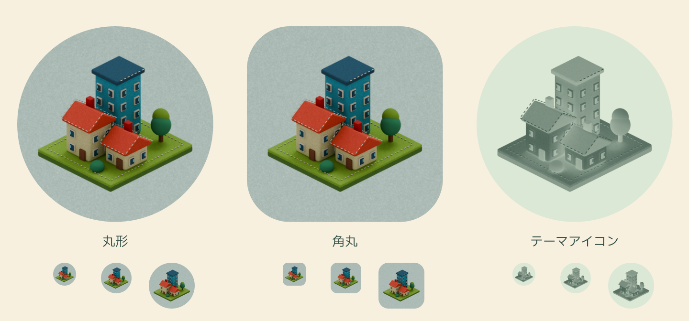
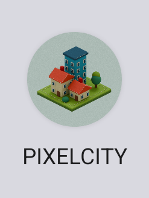

# フェルトのアプリアイコン（0.4.3）

既存の「青いビル・赤い屋根の集合住宅・小さな住宅」という3棟のモチーフを残し、
ゲームと同じ毛羽・凹凸を持つフェルト素材で立体的に作り直した。
窓は厚みのある布のアップリケ、屋根と緑の土台には生成りの縫い目を付けた。
背景も淡い青緑のフェルトで、樹木と建築の角を丸くした。



## Androidへの組み込み

- 前景：`res/drawable-nodpi/launcher_felt_foreground.png`、648×648、透過PNG。
- 背景：`res/drawable-nodpi/launcher_felt_background.png`、432×432、不透明PNG。
- 単色版：`res/drawable-nodpi/launcher_felt_monochrome.png`、648×648。布の明暗をアルファへ変換し、テーマ色で染めても建物・窓・縫い目を読み取れるようにした。
- 既存の `ic_launcher_*.xml` は各画像を表示するBitmapDrawableへ変更。Manifestの通常・丸形アイコンは引き続き同じAdaptiveIconDrawableを使用する。
- 前景と背景は別レイヤー。Androidの切り抜き・動きに対応し、最終画像の不透明部分も中央の安全円内であることを検査した。実測半径183.66px、安全半径198px。

外部画像や外部3Dモデルは使用していない。独自制作、MIT。
[生成コードと画像のハッシュ](../visual-source/icon/sources.json)を記録した。

## 再生成

```sh
nix shell nixpkgs#blender --command blender -b -t 12 -P tools/realistic/build_icon.py
python3 tools/realistic/package_icon.py
```

Blender 5.1.1 / Cyclesで3Dからレンダリング。`felt_materials.py`はゲームと共用。
梱包時はffmpegで縮小と単色用アルファ変換を行い、librsvgでマスクの比較画像を出力する。
制作時の大きなPNGは `artifacts/felt-icon/`、アプリには上記3画像のみを収録。

512×512の書き出し： [丸形](images/felt-icon-circle.png) / [角丸](images/felt-icon-rounded.png) / [正方形](images/felt-icon-square.png)。

## 検証と実機更新

2026-09-12。versionName **0.4.3**、versionCode **10**。

- debug / releaseビルド成功。releaseはR8を含めて確認し、release署名は未設定。
- Lint debug / releaseはエラー0、既存警告37。変更はアイコン資産と版番号のため、ゲームロジックのテスト追加・全件再実行は行っていない。
- APK内の前景・背景・単色版の3画像と、その寸法を確認。
- 専用エミュレータ（Android 15 / API35、1080×2400、420dpi）のPixel Launcherで新アイコンを目視し、アイコンのタップからゲームが起動することを確認。
- 丸形・角丸、48 / 64 / 96pxの縮小表示とテーマ用単色版は、Androidのレイヤー拡張率を再現した合成プレビューでも確認。実際のテーマ色は端末の設定に従う。



日常使用のPixel 10aは0.4.2から上書き更新した。保存ファイルを事前退避し、更新直後・起動後とも内容が更新前とバイト単位で一致。
`am start -W`はStatus: ok、COLD、TotalTime820ms。起動プロセスにAndroidRuntimeのFATAL EXCEPTIONなし。
実機へのテスト操作の注入・初期化は行っていない。

インストールしたAPK：`artifacts/PIXELCITY-0.4.3-debug.apk`（開発用署名）。

- サイズ：15,781,965 bytes
- SHA-256：`02ab074c3f7ce1fa5ddf3eecb2ba6641c09b769259b8879c4e2649a21f1b9100`
- 署名証明書SHA-256：`2c53b411c1193758289715cc230989564a571259b2eb4f5702b774c07a515e87`

証跡：`artifacts/felt-icon/build.log`、`apk-verification.json`、`launcher-colour.png`、`emulator-activities.txt`、`device/update-evidence.json`。
保存内容は私的なローカル退避のみ。GitHubへのcommit・push、Play Consoleへのアップロード・公開は行っていない。
