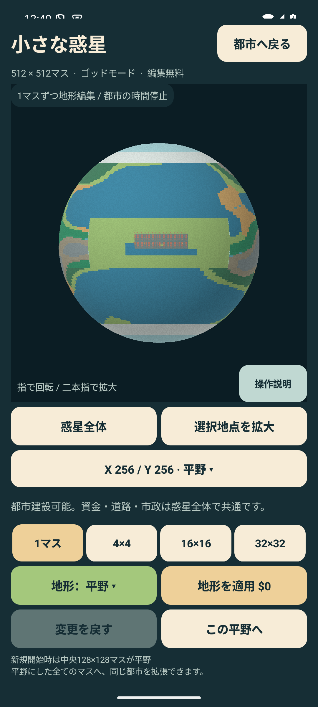
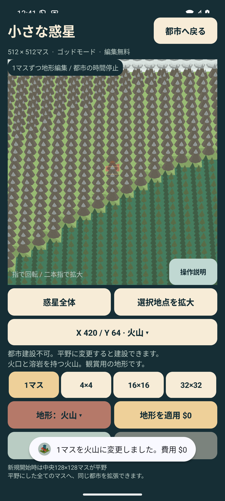
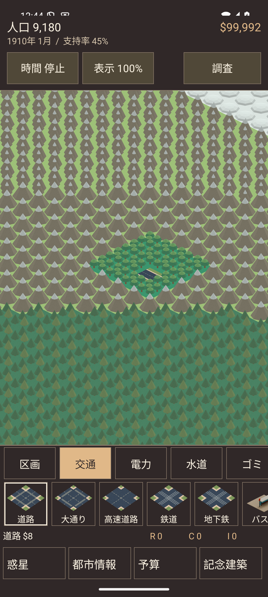

# 512×512惑星・地形編集の検証

2026-09-13。PIXELCITY **0.5.0 / versionCode 11**。

## 確認した仕様

- 1枠に1つの512×512＝262,144マスの都市を保存する。
- 新規開始時は中央128×128（X・Y=192〜319）の全16,384マスが建設可能な平野。
- 11地形を個々のマスに設定。初期平野の外でも、平野へ変えたマスに共通の市財政で建設できる。
- 無料編集、時間停止、1マス・4×4・16×16・32×32の筆、取消、建築保管・復元、v6保存に対応。
- 惑星は実時間3D。都市では同じ3D地形から生成した画像をクオータービューで表示する。
- 神の操作の案内は、ひよりの就任日誌を終えた後に1回だけ表示。機能自体は新規開始の時点から使用可能。

## ホスト上の検証

`testDebugUnitTest assembleDebug assembleDebugAndroidTest lintRelease assembleRelease` 成功。

- JVM単体テスト **237件、失敗0、除外0**。
- 新規のPlanetTestは10件。初期平野全域、1マス編集、全非平野の建設禁止、旧都市の座標移行、資金・物語の維持、記念建築の占有範囲、保管・復元・取消、経度の継ぎ目、v6の全地形とカメラの保存、欠損・矛盾データの拒否、11モデルの立体形状、表裏の球面選択を確認。
- Lint release：エラー0、既存警告37。今回追加の画面・描画の警告は解消。状態を引数に持つ2つの画面はXMLから生成しないため、ViewConstructorの対象外であることをコードに明記。
- releaseはR8を含めてビルド。release署名は未設定。実機更新には既存と同じ開発用署名のdebug APKを使用。
- `git diff --check` 成功。

最終のビルド記録は `artifacts/tile-planet/build.log`。

## Androidと画面の検証

専用エミュレータ `promo35` / Android 15 API35、1080×2400、420dpi、ソフトウェアGPU。
**Androidテスト62件の全てについて成功を確認**。分割実行し、重複を除いた一覧を `artifacts/tile-planet/test-results.json` に保存。

新規のPlanetFlowTestは6件。

1. 新規開始から「惑星」を実際に押し、512×512と初期平野全域を確認。地形変更で資金・月・就任日誌が変化しない。
2. 座標X420・Y64の1マスを火山に変更し、隣のマスは変化しない。平野へ変更して「この平野へ」で都市画面のカメラが同じ座標へ移動し、共通資金から道路1本分だけ支払う。再生成・読込後も道路と惑星の選択座標を保持。
3. 実際の回転・二本指拡大、座標入力、11種類全ての地形ボタン、全景への復帰。
4. 発電所を海の下に保管し、Activityの停止・再開と保存を経ても、平野へ戻すと復元。資金は不変。
5. 就任日誌の後の短い説明を一度だけ表示し、再開時には重ねて表示しない。
6. 最大の32×32筆で1,024マスを熱帯雨林へ変え、変更済みのGPUフレームを待って表示を確認。取消は全マスを復元。4×4の熱帯雨林の中で1マスだけを平野にし、その1マスだけに道路を建設して、都市画面の実画像を保存。山頂の雪が地面・山体に隠れないこともBitmapの画素値で検査。

旧機能の56件には、3シナリオの分岐・政策・完成後の継続、車と歩行者、各都市の外観、税率と市長メニュー、ピンチ・選択、10保存枠、就任日誌、音声、タイトル・大文字設定・記念建築が含まれる。

初回の連続実行では、稼働中の都市の無期限idle待ちでテスト側が停止した。都市を開いた同じUI処理内で停止し、初回描画の完了を待つようPlanetFlowTestとVisualRenewalTestを修正。未完了の対象は再実行して成功を確認した。
検証中に発見した、都市初回レイアウトによる指定カメラ位置の上書きと、地形画像の面の重なりも修正し、該当テストを再実行した。

### 実際の表示

全景では遠い地形をまとめて表示し、拡大すると各マスの立体モデルを表示する。描画距離に関わらず編集・保存は1マス単位。

## 実機への更新

接続中の **Pixel 10a** を0.4.3（code10）から **0.5.0（code11）** へ更新。

- インストール済みAPKと今回のAPKの署名証明書が一致することを確認。
- 保存ファイルをローカルの無視対象フォルダへ退避した後、対象serialを明示し `install --no-incremental -r` で上書き。Success。
- 保存ファイルは更新直後と起動後の両方で、更新前と**バイト単位で一致**。
- `am start -W`：Status `ok`、COLD、TotalTime **841ms**。起動したPIDにFATAL EXCEPTIONなし。
- 実機でのジェスチャー注入・初期化・保存都市の操作は行っていない。ゲーム内操作と旧都市の512×512移行は、エミュレータと単体テストで検証した。

APK：`artifacts/PIXELCITY-0.5.0-debug.apk`（16,192,370 bytes）。

- SHA-256：`32c595420b90c478cff281bf859bbbf2a4c48b8bbce8c3871e73902e9fdc43b6`
- 署名証明書SHA-256：`2c53b411c1193758289715cc230989564a571259b2eb4f5702b774c07a515e87`

更新記録：`artifacts/tile-planet/delivery.json`、`device-install.log`、`device-launch.log`。保存内容は非公開のローカル退避のみ。
GitHubへのcommit・push、Play Consoleへのアップロード・公開は行っていない。
