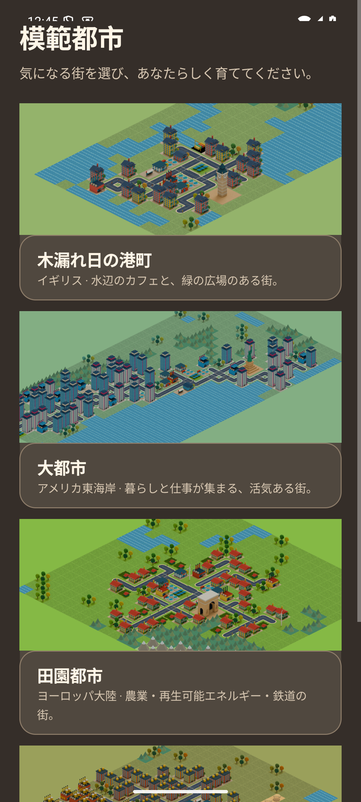
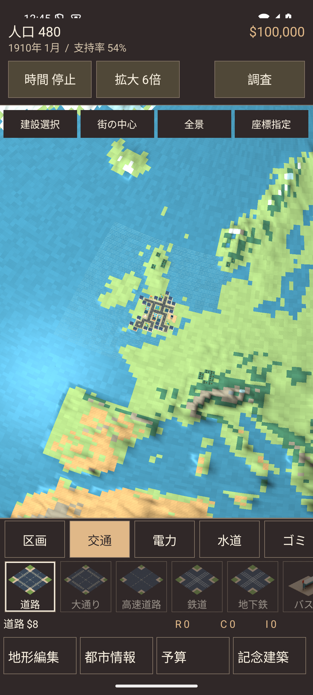
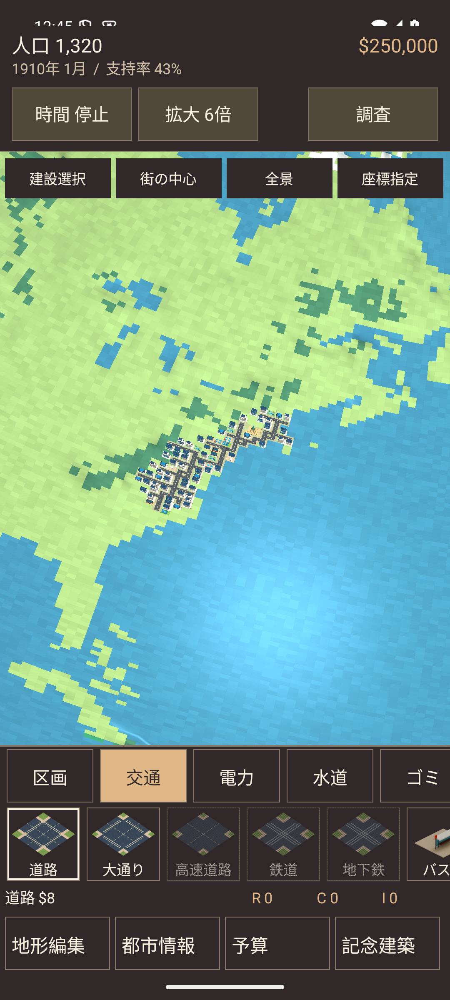
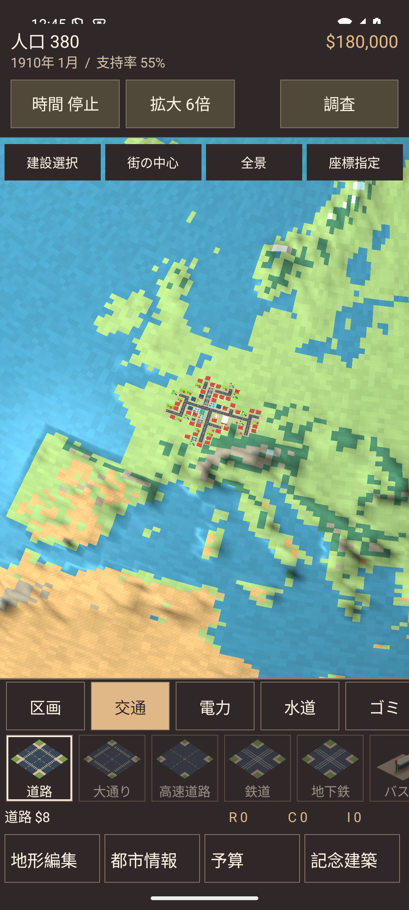
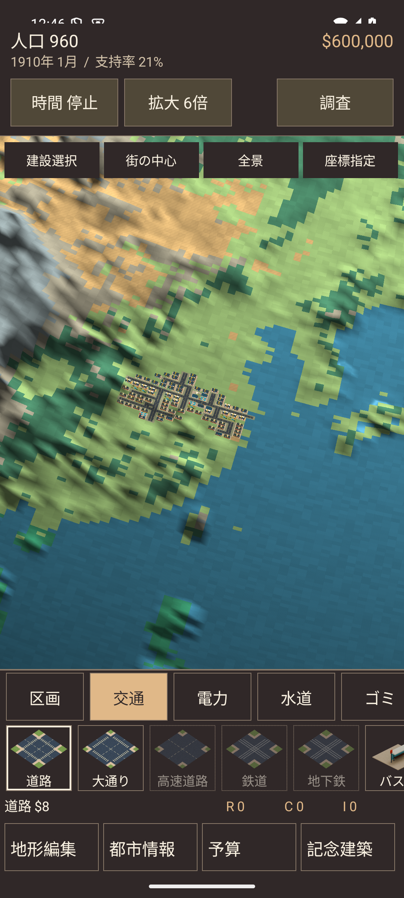

# 地域ごとの模範都市と地形編集（0.6.1）

2026-09-13。versionCode 16、applicationId `io.github.hatake716.pixelcity`。

## 変更した動作

メニュー・案内・資料の機能名を「地形編集」に統一した。編集トレイと座標指定では市政の時計だけを止め、BGMを継続する。市長メニューが音声を一時停止した場合は編集開始時に再開する。適用・取消・完了で同じ曲を先頭から再生し直さず、BGM無効設定とActivity休止中の音声停止を保持する。チュートリアルの速度制限中でも、地形編集は時計を停止する。

ユーザーの指定に従い、地域配置の変更は**新しく開始する模範都市だけ**に適用する。保存済みの模範都市を判別して再生成する処理は設けていない。既存の都市・資金・建設・編集した地形・保存位置はそのまま再開する。

| 模範都市 | 地域 | 構成 |
|---|---|---|
| 木漏れ日の港町 | イギリス | イングランド・ウェールズの低地に沿った住宅・商店・広場。港は元の海岸に隣接。ビッグベン |
| 大都市 | アメリカ東海岸 | 北東部から中部沿岸に続く道路と住宅・商業街区。自由の女神 |
| 田園都市 | ヨーロッパ大陸 | 西欧の低地に農地、再生可能エネルギー、鉄道、緑地。凱旋門 |
| 工業都市 | 中国大陸 | 東部の低地に工業・電力・廃棄物処理を集め、住宅との間に商業・緑地を配置 |

`RegionalShowcase`は既存のEarthTerrainデータを使う。地域範囲内の平野・森林・熱帯雨林・砂漠のうち標高900m以下を候補にし、中心から陸上でつながる範囲だけを採用する。海・川・山・離島を横断して道路を通さない。512×512格子で海峡がつながって見える場合も、英国と欧州大陸の街区を別々の岸に制限する。

地域内の経由地点を陸上の道路で結び、その周囲へ街区を広げる。**建築・道路の敷地だけ**を平野にし、空き地・海岸線・山地を保持する。現実の道路網や実在都市の精密再現ではなく、地球由来の粗い土地格子に合わせたゲーム用の街である。街の規模・公共設備も地域の広さに合わせて作り直している。

選択画面は各地域の小さな切り出し（最大544マス）を描画し、選択した街だけを262,144マスの惑星へ展開する。プレビューのために4個の惑星を同時生成しない。既存の描画予算・モデルの上限・キャッシュ制限を維持する。

## 経営と保存の検証

`RegionalShowcaseTest`で4地域全てについて、次を検証する。

- 全ての建築・道路が指定した地域の元の陸地に収まり、海・川を埋めず、山へ建築しないこと。
- 未建設マスは全262,144マスを元データと比較し、土地属性が一致すること。
- 街全体を四角く埋めず、港が英国の海に接し、道路に接続すること。
- 初期状態の全住宅・商業・工業区画で道路・電力・給水がそろうこと。給水半径の届かない端部には給水塔を補うこと。
- 保存・再読込で地域の座標と建築を保持し、別の初期位置を指定しても現行の保存済み惑星を移動しないこと。
- 小さなプレビューの再現性、都市ごとの建築・農地・発電・工業の特徴。
- 実際の512×512へ展開した各都市を災害なしで24か月進め、人口の維持、資金増、電力・水道の需給、財政破綻しないこと。

| 都市 | 初期人口 | 24か月後の人口 | 初期資金 | 24か月後の資金 |
|---|---:|---:|---:|---:|
| 港町 | 480 | 480 | 100,000 | 101,224 |
| 大都市 | 1,320 | 1,040 | 250,000 | 257,013 |
| 田園都市 | 380 | 740 | 180,000 | 182,905 |
| 工業都市 | 960 | 960 | 600,000 | 604,277 |

これは操作しない場合の一定条件での回帰検証であり、災害や任意の建設・税率変更後の収支を保証するものではない。

## Android操作検証

API 35・1080×2400の開発用エミュレーターで`RegionalCityFlowTest`を実行する。選択画面から4都市を開始し、地域座標・人口・保存位置を確認。実際に合成されたSurfaceViewの画面を、街・周辺地域・惑星全体の3倍率で取得する。

既存の北米の港町に資金と火山地形の変更を入れた保存を用意し、再開後と保存後の全建築・段階・土地属性が一致することを検証する。

音声は実際のAudioTrackで検証する。同じ再生トラックの再生位置が、編集中・地形適用後・取消後・完了後・市長メニューからの再開後も進むこと、アプリ休止中は止まり復帰後に続くこと、BGM無効設定時に再生しないことを確認する。チュートリアル中の編集でも時計を止める。

最終の製品APKで`RegionalCityFlowTest`4件、`UnifiedCityTest`6件、`PlanetFlowTest`6件の**計16件が成功**した（233.079秒、`android-final.log`）。新規地域配置・既存保存・BGMに加え、球面での建設・撤去・費用・ピンチ・車と歩行者・画面復帰、11種類の地形、最大筆・取消・保管建築の復元・チュートリアル後の案内を確認した。

ログ・画面・ビルド検証はGit管理外の`artifacts/regional-cities/`に保存する。

JVMテストは254件成功、失敗・スキップ0件。Lintはエラー0件・既存警告37件。Debug・AndroidTest・Release（R8）のビルドに成功した。全644モデルとモデル一覧、726,504 bytesの地形データがDebug・Release双方でソースと一致することを確認した。

### 実際の配置画面

選択カードには地域名と、その地域の街のプレビューを表示する。

| 港町・イギリス | 大都市・アメリカ東海岸 |
|---|---|
|  |  |

| 田園都市・ヨーロッパ大陸 | 工業都市・中国大陸 |
|---|---|
|  |  |

## 配布物

実機更新用APK：`artifacts/PIXELCITY-0.6.1-debug.apk`、24,958,854 bytes。従来の実機インストールと同じDebug署名を使う。

- APK SHA-256：`f7d7aef43aa9d0f1668f3d702c6ea2d0df1d559b72028da7b01c6046aa602226`
- 署名SHA-256：`2c53b411c1193758289715cc230989564a571259b2eb4f5702b774c07a515e87`
- Release APKはR8・資源縮小のビルド検証用の未署名版（20,669,901 bytes）。

GitHubへの公開、Play Consoleへの提出は行っていない。

## 実機への更新

2026-09-13 12:50 JST、Pixel 10aを0.6.0 / versionCode 15から**0.6.1 / versionCode 16**へ、同じ署名のAPKで`install --no-incremental -r`更新した。

- 更新前のAPKとSharedPreferencesを、Git管理外・所有者だけが開けるディレクトリへ退避。署名一致とインストール成功を確認。
- 最初の起動照会はAndroidの`PackageUpdateActivity`を返したため、更新処理後に再確認。アプリ本体の`MainActivity`、`Status: ok`、稼働中PIDを確認した。
- 更新直前のSharedPreferencesは空（保存項目0件）だった。更新後の取得時には`city_0`が新規に追加されており、XMLファイル全体のバイト一致ではない。実機上の都市データを消去・初期化する操作は行っていない。保存済み都市の互換性は、エミュレーターに用意した旧模範都市の全建築・段階・地形と資金で検証した。
- 実機から読み戻したAPKと配布APKのSHA-256が一致。確認した起動プロセスの致命的例外はなかった。
- 実機のデータ消去・アンインストール・操作入力・Instrumentationテストは実施していない。操作・音声・描画・既存保存の互換性は開発用エミュレーターで検証し、実機では上書き更新と起動を確認した。

記録：非公開の`artifacts/regional-cities/device/delivery.json`。
