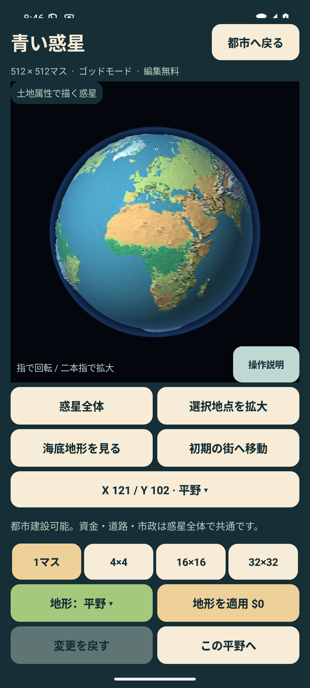
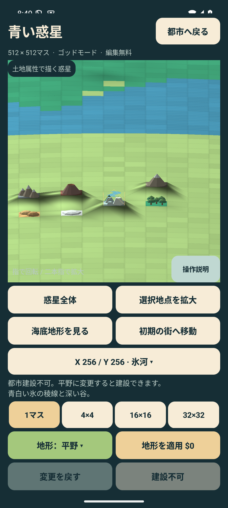
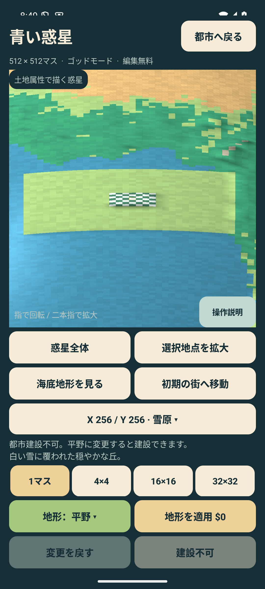

# 土地属性から描く惑星（0.5.3）

2026-09-13。versionCode 14、applicationId `io.github.hatake716.pixelcity`。

## 表示の変更

球体へ衛星写真を貼る処理を廃止し、現在の保存データの512×512＝262,144マスを直接描く。平野・海・川・山・山脈・火山・森林・熱帯雨林・砂漠・雪原・氷河の11属性に対応する。地形編集の変更・取消、保存後の再開でも同じ土地属性を表示する。

- 1マスをRGBAの1画素へ変換し、RGBに属性色、Aに属性IDを保存。透明度として扱わず、GLへ直接転送する。全体で1 MiB。
- 球面の経度と緯度の正弦から、ゲームと同じ等積格子のマスを求める。最近傍サンプリングを使い、隣接マスの属性色を混ぜない。全景の地面形状が2マス刻みでも、色は奇数・偶数座標を含む全マスから求める。
- 拡大すると布の織り目と縫い目、水面の波、川岸、砂の筋が見える。
- 8倍以上の拡大では、注視点周辺の32×32マス以内に木・砂丘・山・火口・氷などの立体物を表示。編集した地形だけでなく、初期状態の地形にも同じ形状を使う。平野は地面自体で表現する。
- 立体物は描画済みの地面の三角形に沿って配置する。高さデータを二重に加算して、山が細長く伸びる問題も修正した。
- 自然な大陸配置と地面の起伏は既存のNASA / GEBCO由来データを維持。衛星写真は初期属性の分類に使用した原資料であり、現在の球体の表面素材には使わない。
- 既存の保存形式v7、都市・財政・建築条件は変更しない。現在保存されている土地属性をそのまま使う。

8 GB端末向けのGPU資源解放、休止中のEGLコンテキスト解放、256 KiBの頂点転送領域、正確な頂点数による配列確保を維持する。遠くの細かな立体物は省略するが、土地属性は常に1マス単位。全球に全ての木を同時配置する実装ではない。

## ソースと検証対象

- `PlanetGeometry.kt`：保存データから属性画素を生成。近隣地形の列挙、地表に沿った立体物の配置。
- `PlanetSurface.kt`：属性素材の生成・選択・更新とGPUへの転送。従来の衛星画像の読込を削除。
- `PlanetView.kt`：表示と操作説明を更新。
- `PlanetTileRenderingTest`：全マスの属性色とID、奇数座標・経度境界、1マス変更・取消、初期地形の立体物、山の高さの二重加算防止、熱帯雨林のメッシュ64 MiB未満を検証。
- `PlanetTileVisualTest`：実際のGLES合成画像で、森林と雪原を交互に設定した隣接マスの色を確認。中央1マスの変更と取消でも9地点の色を照合。11属性を並べた拡大画像も確認。
- `EarthVisualTest` / `PlanetFlowTest`：全景、起伏、海底切替、初期地点、回転・ピンチ、11属性の操作、最大の筆、都市での表示・建設、保管と復元、保存・再開。
- `RenderMemoryTest` / `PerformanceProbeTest`：キャッシュ解放後の表示と都市状態、30回の都市・惑星往復。

自動テストと画面確認は、実際の保存枠を初期化できる開発用エミュレーターで実施する。実機の保存をテスト用データで上書きしない。

## 検証結果

- JVM **247件成功、失敗0件**。今回追加した5件を含む。
- Lint **エラー0件、既存警告37件**。Debug・AndroidTest・Release（R8）のビルド成功。
- Android 15 / API 35、1080×2400の `emulator-5580` で、今回の対象**16件の成功を確認**。内訳はPlanetTileVisualTest 2、EarthVisualTest 3、PlanetFlowTest 6、RenderMemoryTest 4、PerformanceProbeTest 1。
- 最終製品APKの連続実行では、初回の撮影がGLES描画の送信後・画面合成前に行われ、背景色を取得した1件が失敗した。他の15件は成功。検証側を固定250 ms待機から、合成画像と対象マスの色の完了待機へ変更し、PlanetTileVisualTest 2件を再実行して成功した（12.338秒）。製品コードの差替えはしていない。
- 取消後の検証画像は編集前とSHA-256まで完全一致。11属性を並べた画像では、山の高さの二重加算がなくなったことも目視確認した。
- Debug・Releaseともに標高・初期属性データ `earth/terrain.bin.gz`（726,504 bytes）と、0.5.3の表示変更を追記した出典・ライセンスを収録。標高データはソースとバイト単位で一致。

ビルド記録は `artifacts/tile-planet/final-build.log`、ライセンス追記後の包装は `package-build.log`、検証APKの最終ビルドは `test-harness-build.log`。Androidの実行記録は `final-regression.log` と `final-tile-visual.log`。過去版の全52件を今回すべて再実行したという意味ではない。

### 画面切替とメモリ

同じ最終製品APKで、新規512×512の地球、人口0、都市の時間停止の状態で都市と惑星を**30往復**し、61地点のPSSを採取。強制GCは使用していない。

| 指標 | 測定値 |
|---|---:|
| 採取時点の最大PSS | 185,067 KiB（180.73 MiB） |
| 1往復後の都市画面 | 182,307 KiB（178.03 MiB） |
| 30往復後の都市画面 | 184,011 KiB（179.70 MiB） |
| 1往復後から30往復後までの差 | 1,704 KiB（1.66 MiB） |
| 未解禁ボタンを含む四角形描画命令 | 101 |

30往復を完走し、初回復帰から64 MiB以上増えない回帰条件を満たした。PSSは共有メモリを按分したプロセス使用量。採取間の瞬間的な最大値、実機での長時間プレイや大人口都市のメモリを表すものではない。資料は `artifacts/tile-planet/performance-final.json`。

### 実際の描画

全景。大陸配置と起伏を残し、各マスを現在の属性色で表示。

11属性を配置した検証用の土地。周辺を平野へ変更した人工的な配置であり、新規ゲームの地形ではない。

森林と雪原を交互に配置した7×7の検証用領域。奇数・偶数座標も個別に表示される。

## 実機更新と配布物

2026-09-13 08:50 JST、Pixel 10a（`62251JEA315065`）の0.5.2を、同じ署名の**0.5.3 / versionCode 14**へ `install --no-incremental -r` で上書き更新した。

- 更新前のAPKと保存データをGit管理外の非公開ディレクトリへ退避し、署名の一致を確認。
- インストール成功、パッケージの版を読み戻して確認、起動 `Status: ok`。確認時にプロセスが稼働。
- 実機から読み戻したAPKと配布APKのSHA-256が一致。
- 更新直前と起動後のSharedPreferencesはバイト単位で完全一致。既存の保存を保持。
- 確認時点の新しい終了記録は更新による正常なプロセス入替のみ。本アプリの新しい致命的例外・ANRを認めなかった。

実機の操作入力を伴うプレイ試験は行っていない。回転・拡大・地形編集・30往復の試験は開発用エミュレーターで実施した。実機更新記録は `artifacts/tile-planet/device/delivery.json`。

配布APK：`artifacts/PIXELCITY-0.5.3-debug.apk`（18,103,111 bytes、実機と同じ署名のDebug版）。Release版はビルド検証のみで未署名。

SHA-256：`472268510b1e56e541d6744c88cacd994e9ce609b3242fa7d4ede32a2ca71b7d`

署名SHA-256：`2c53b411c1193758289715cc230989564a571259b2eb4f5702b774c07a515e87`

GitHub公開・Play Consoleへの提出は実施していない。
