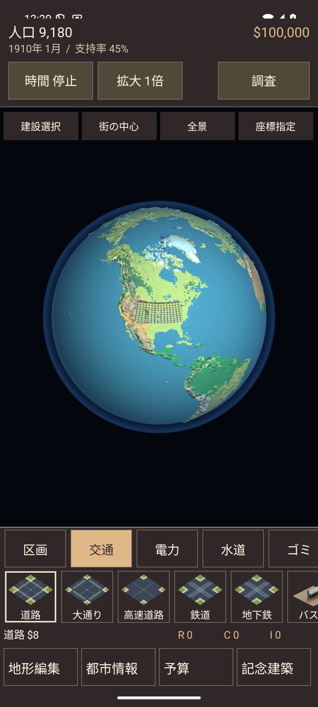
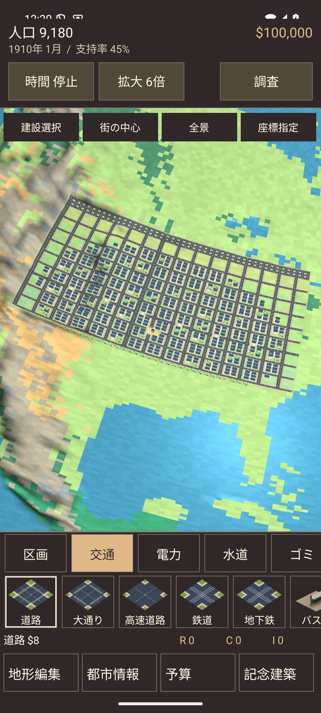
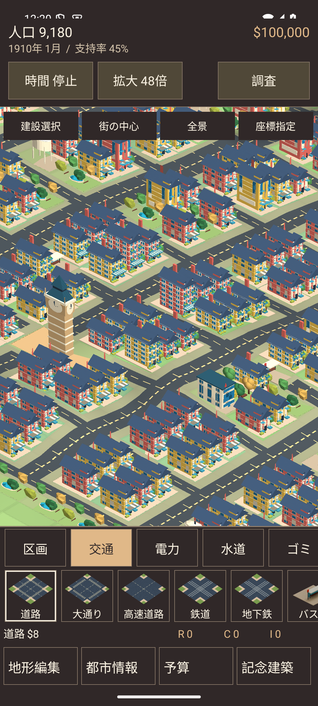
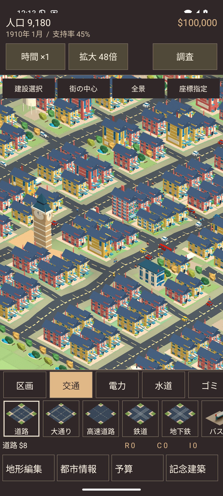

# 球体都市の統合（0.6.0）

2026-09-13。versionCode 15、applicationId `io.github.hatake716.pixelcity`。

## 変更後の動作

都市モードと惑星モードを同じGameView・PlanetSurfaceへ統合した。512×512マスの一つのCityを球面に表示し、その画面で建設・撤去・調査・財政・公共サービス・チュートリアル・シナリオを操作する。街へ近づくと斜め上から建物を見渡し、縮小するとその街を含む惑星全体が現れる。

- 「建設選択」は一本指で範囲を選び、「実行」で費用を支払う。二本目の指が触れたときは、その操作で始めた建設選択を取り消してカメラ移動へ移る。
- 「視点移動」は一本指で球体を回転。二本指の中心点と拡大率を使い、ピンチ中に持っている地面を指の下へ保つ。
- 「街の中心」「全景」「座標指定」は同じ球体のカメラだけを動かす。市政データや描画画面を作り直さない。
- 「地形編集」は同じ球面上に開くトレイ。11地形、1マス・4×4・16×16・32×32の筆、取消、座標指定、海底表示を使用できる。費用は無料、時計は停止。完了後は同じ土地へ建設できる。
- 平野以外への建設禁止、建築の保管・平野へ戻した際の復元、既存10保存枠、保存形式v7を保持する。0.5.3の都市・地形を初期化しない。
- 就任日誌は建設候補が案内欄・実行ボタンに隠れない位置と倍率へ自動調整する。シナリオの完成後も実際に建てた街へカメラを向ける。

## 描画と負荷の制限

既存のフェルトデザイン322種類を頂点・法線・色の実際の3Dモデルへ変換。都市様式別の建築、公共施設、記念建築、車両、人物を含む。同じモデルに遠景用の簡略版を322個用意した。地面の三角形と各マスの接平面から建物の配置・大きさ・向きを決める。道路と線路は隣接接続に合わせて球面へ描く。

- 道路、区画、施設の敷地とサービス重ね地図は512×512の1 MiBテクスチャ。地形と同じ1マスを参照する。
- GLスレッドには不変のGlobeTownを渡す。変化のないフレームで都市全体を複製しない。市政が進んでも地形メッシュを再作成しない。
- モデルのGPUキャッシュは24 MiB。圧縮モデルを256 KiBの転送領域で読み、巨大な複製配列を作らない。一度の描画で読み込む新規モデルは4個まで。
- 一度に描くモデルは最大600個・120万頂点。詳細モデルには約25万頂点までを割り当て、それ以降は最大1,791頂点の遠景モデルを使用。3倍未満では建物の細部を省略し、敷地と道路を表示する。
- 車両60・歩行者40までの描画枠を確保し、交通量の多い都市でも歩行者が消えないようにした。車の経路・速度は既存TrafficAnimation、散歩経路はPedestriansに従う。
- 地形の詳細範囲、メッシュ配列の正確な確保、GPU資源とEGLコンテキストの休止時解放、既存画像キャッシュの制限を維持。
- カメラ移動中は保存データ全体を書き直さず、指を離した際に保存する。球面の選択判定では三角形ごとの一時ベクトル生成を避け、建物の見えている外形も選択対象にする。

織り目はシェーダーで描画。モデルはゲーム用の簡略表現で、個々の縫い糸の立体化や写真測量による復元ではない。遠景では表示予算に応じて細部を省略するが、土地・建設・保存の単位は常に1マス。

## 検証

JVMでは251件成功、失敗0件。追加したGlobeTownTestの4件は、全都市様式・全建築に対応するモデルの存在、通常版と遠景版の全644ファイルの頂点数と内容、道路接続、不変スナップショット、サービス表示の段階、経度境界、傾斜した球面カメラからの選択を検証する。

Androidの操作は、保存を初期化できるAPI 35 / 1080×2400の開発用エミュレーターで検証する。SurfaceViewは通常のView.drawには写らないため、球面の見た目はUiAutomationの実際の合成画面でも確認する。

| 対象 | 検証内容 |
|---|---|
| UnifiedCityTest | 近景・遠景が同じ画面とCityであること、球面での建設・撤去・費用、ピンチの固定点と誤建設防止、車と歩行者、地形編集と取消、バックグラウンド復帰 |
| PlanetFlowTest | 就任直後の地形編集、離れた平野への建設と再開、全11地形、32×32の筆と取消、保管建築の復元、一度だけの終了案内 |
| PlanetTileVisualTest / EarthVisualTest | 隣接マスの色、1マスの編集と取消、11地形の立体物、大陸・山脈・海底・自然な初期平野 |
| StoryFlowTest / CampaignFlowTest | 新規開始から就任日誌18場面、予算画面での時間停止、3シナリオへの分岐・政策・完成後の継続 |
| SaveSlotTest | 保存・再開・保存枠操作・都市の色設定 |
| RenderMemoryTest / PinchZoomTest | 既存画像の解放・復帰、状態維持、旧描画のピンチ回帰 |
| PerformanceProbeTest | 全景と街の拡大表示の反復、描画完了を待ってPSSを採取 |

初回の対象35件では、チュートリアルの候補地が案内欄に隠れる不具合と、案内ダイアログを閉じた直後の非同期待機不足が見つかった。候補地を可視範囲へ収めるよう製品側を修正し、案内終了の待機を検証側へ追加。車・歩行者と球面ピンチの新規検証、保存枠を含む28件の再実行は全て成功した（136.458秒）。

記録は`artifacts/unified-city/regression.log`、`refinement.log`、`final-build.log`。過去版の検証記録は各バージョンの資料として保持する。

今回の対象は、修正後の再実行を含め**異なる51テストで成功を確認**。JVM 251件、Lintはエラー0・既存警告37件。Debug・AndroidTest・Release（R8）のビルドに成功した。製品APKを変えずに、撮影側にHUDの描画と指定倍率の完了待機を追加し、全景・街・近景の合成画像を再確認した（`final-capture.log`、10.012秒）。

### メモリ測定

最終製品APKで、空の街と人口9,180人の「木漏れ日の港町」をそれぞれ**30往復**。前者は1倍と24倍、後者は1倍と48倍を往復し、要求した倍率の描画とモデル読込の完了を待って61地点ずつPSSを採取した。時計は停止、強制GCは使用していない。

| 条件 | 採取時点の最大PSS | 1往復後 | 30往復後 | 1往復後からの差 |
|---|---:|---:|---:|---:|
| 空の街 | 210,942 KiB（206.00 MiB） | 202,594 KiB | 201,502 KiB | −1,092 KiB |
| 人口9,180人の街 | 203,546 KiB（198.78 MiB） | 203,546 KiB | 202,970 KiB | −576 KiB |

両方とも完走し、64 MiB以上増えない回帰条件を満たした。PSSは共有メモリを按分したプロセス使用量。採取間の瞬間的な最大値や、実機の長時間プレイを測定した値ではない。資料は`performance-final.json`、`performance-dense.json`、実行ログは`final-performance-empty.log`と`final-performance-dense.log`。

### 実際の画面

同じ「木漏れ日の港町」を遠景から近景へ。球体にも道路と敷地が残り、経営UIを維持する。

## 実機更新と配布物

2026-09-13 12:20 JST、Pixel 10a（`62251JEA315065`）を0.5.3から**0.6.0 / versionCode 15**へ`install --no-incremental -r`で更新。

- 旧APKと保存データをGit管理外の非公開ディレクトリへ退避し、新旧の署名一致を確認した。
- インストール成功、パッケージ版の読み戻し、起動`Status: ok`、更新後のプロセス稼働を確認した。
- 更新直前と起動後のSharedPreferencesはバイト単位で完全一致。既存の保存を保持した。
- 実機から読み戻したAPKと配布APKのSHA-256が一致。確認した起動プロセスの致命的例外はなかった。
- 操作・描画・反復試験は開発用エミュレーターで実施。実機では操作入力を伴うプレイ試験をしていない。

配布APK：`artifacts/PIXELCITY-0.6.0-debug.apk`、24,925,914 bytes（約23.77 MiB）。実機と同じ署名のDebug版。

SHA-256：`33efd5fd5c415e1232df8f84a4260cc6aeaf498fdad041a04b593dbad38cc8ff`

署名SHA-256：`2c53b411c1193758289715cc230989564a571259b2eb4f5702b774c07a515e87`

Debug・Releaseとも全644モデル、モデル一覧、出典、726,504 bytesの地形データがソースと完全一致することを確認。Release APKはビルド検証用の未署名版（20,665,769 bytes）。GitHub公開・Play Console提出は行っていない。記録は`artifact-validation.json`と非公開の`device/delivery.json`。

## 生成・再現

1. Blenderで`tools/realistic/export_globe_models.py`を実行する。
2. Pythonで`tools/realistic/build_globe_lods.py`を実行し、遠景モデルと選択用の外形範囲を生成する。
3. `./gradlew assembleDebug assembleDebugAndroidTest testDebugUnitTest lintDebug assembleRelease`。
4. 操作テストは明示した開発用エミュレーターだけで実行する。実機へInstrumentationテストを実行しない。

モデルの来歴・形式は[素材資料](ASSETS.md)、フィールドと保存仕様は[惑星の仕様](PLANET.md)を参照。
